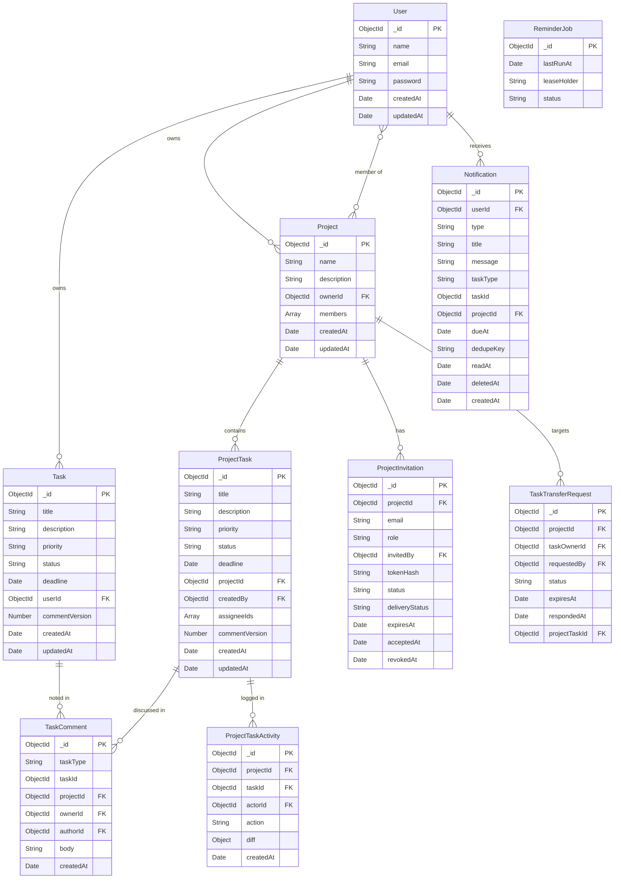

# Software Requirements Specification (SRS)
## Task Manager — Full-Stack Personal & Collaborative Project Management System

---

| Field | Detail |
|---|---|
| **Document Title** | Software Requirements Specification — Task Manager |
| **Document Version** | 1.0.0 |
| **Project Name** | Task Manager |
| **Prepared By** | Software Engineering Project Team |
| **Date** | November 2026 |
| **Standard** | IEEE Std 830-1998 (IEEE Recommended Practice for Software Requirements Specifications) |
| **Status** | Final — Release Candidate |
| **Repository Path** | `D:\task-manager` |

---

## Table of Contents

1. [Introduction](#1-introduction)
   - 1.1 Purpose
   - 1.2 Document Conventions
   - 1.3 Intended Audience
   - 1.4 Project Scope
   - 1.5 Definitions, Acronyms, and Abbreviations
   - 1.6 References
2. [Overall Description](#2-overall-description)
   - 2.1 Product Perspective
   - 2.2 Product Functions Summary
   - 2.3 User Classes and Characteristics
   - 2.4 Operating Environment
   - 2.5 Design and Implementation Constraints
   - 2.6 Assumptions and Dependencies
3. [System Features — Functional Requirements](#3-system-features--functional-requirements)
   - 3.1 Authentication & Identity Management
   - 3.2 Personal Task Management
   - 3.3 Personal Task Metrics Dashboard
   - 3.4 Personal Task Comments & Notes
   - 3.5 Project Workspace Management
   - 3.6 Role-Based Access Control (RBAC)
   - 3.7 Project Membership & Email Invitations
   - 3.8 Collaborative Project Tasks
   - 3.9 Personal-to-Project Task Transfer Workflow
   - 3.10 Project Task Activity Audit Log
   - 3.11 Task Comment System
   - 3.12 Deadline Reminder & Notification Engine
   - 3.13 In-App Notification Management
   - 3.14 Due-Date Calendar View
4. [External Interface Requirements](#4-external-interface-requirements)
   - 4.1 User Interface Requirements
   - 4.2 Hardware Interfaces
   - 4.3 Software Interfaces
   - 4.4 Communications Interfaces
5. [Non-Functional Requirements](#5-non-functional-requirements)
   - 5.1 Security Requirements
   - 5.2 Performance Requirements
   - 5.3 Reliability & Availability
   - 5.4 Scalability Requirements
   - 5.5 Maintainability & Testability
   - 5.6 Usability Requirements
6. [Data Model & Schema Specification](#6-data-model--schema-specification)
   - 6.1 Entity Overview
   - 6.2 Field-Level Specifications
7. [System Constraints & Limitations](#7-system-constraints--limitations)
8. [Appendix A — Requirement Traceability Matrix](#8-appendix-a--requirement-traceability-matrix)

---

## 1. Introduction

### 1.1 Purpose

This Software Requirements Specification (SRS) defines the complete functional and non-functional requirements for the **Task Manager** web application. It establishes a formal baseline for:

- System implementation and development validation
- Software architecture and database schema design decisions
- Test plan formulation and test case verification
- Stakeholder alignment and feature acceptance criteria

This document governs the entire software product as implemented in the repository at `D:\task-manager`.

### 1.2 Document Conventions

- **SHALL / MUST** — Mandatory requirement. The system must implement this.
- **SHOULD** — Recommended requirement. Deviation requires justification.
- **MAY** — Optional feature. Implementation is at developer discretion.
- Requirements are tagged with unique identifiers in the format `FR-MODULE-###` (Functional Requirement) and `NFR-CATEGORY-###` (Non-Functional Requirement) for traceability.
- Bold text marks a **defined term** on first use.

### 1.3 Intended Audience

| Audience | Purpose |
|---|---|
| Development Team | Implementation baseline and design authority |
| Software Architects | Architecture decision alignment |
| QA / Test Engineers | Basis for test plan, test case design, and coverage targets |
| Project Managers | Scope baseline and sprint planning reference |
| Academic Evaluators | Formal deliverable assessment |

### 1.4 Project Scope

**Task Manager** is a secure, responsive, full-stack web application that serves dual purposes:

1. **Personal Task Workspace:** Allows individual users to create, track, prioritize, and manage private tasks with deadlines, status workflows, personal notes, and progress metrics.

2. **Collaborative Project Platform:** Enables multi-user project workspaces with strict Role-Based Access Control (RBAC), tokenized email invitations, collaborative task assignment, audit history, and team comment discussions.

The system further automates deadline awareness through a background scheduled process that dispatches tiered in-app notifications and provides a visual month-view calendar for due-date planning.

**Out of Scope (Current Version):**
- Real-time WebSocket live event streaming
- Third-party OAuth / Single Sign-On (Google, GitHub)
- Kanban drag-and-drop board interface
- Native mobile applications (iOS/Android)
- File attachment or document upload on tasks
- Billing, subscription management, or payment processing

### 1.5 Definitions, Acronyms, and Abbreviations

| Term | Definition |
|---|---|
| **JWT** | JSON Web Token — a compact, URL-safe bearer token encoding user identity claims, signed using HMAC-SHA256 |
| **HTTP-only Cookie** | A browser cookie inaccessible to JavaScript, preventing XSS-based token theft |
| **RBAC** | Role-Based Access Control — a permissions model enforcing access based on the user's assigned project role |
| **CRUD** | Create, Read, Update, Delete — standard data operations |
| **bcrypt** | A adaptive password hashing function using the Blowfish cipher with configurable salt rounds |
| **SPA** | Single Page Application — a client-side web application where routing happens without full page reloads |
| **REST** | Representational State Transfer — an HTTP-based architectural style for APIs |
| **ODM** | Object Document Mapper — Mongoose's abstraction layer over MongoDB (analogous to ORM for relational databases) |
| **Replica Set** | A group of MongoDB instances hosting identical data, enabling high availability and multi-document ACID transactions |
| **Cursor Pagination** | A pagination technique using stable (timestamp, ID) cursors instead of skip-based offsets to avoid degraded query performance on large collections |
| **Deduplication Key** | A unique compound string key that prevents duplicate notification delivery for the same task, recipient, and reminder stage |
| **Cron Daemon** | A background process scheduled on a time-based interval (via `node-cron`) to perform automated work |
| **SHA-256** | A cryptographic hash function producing a 256-bit digest; used to store invitation token hashes without exposing raw tokens |
| **E2E Test** | End-to-End browser test driving real user interactions through an automated browser (Playwright + Google Chrome) |
| **CSP** | Content Security Policy — an HTTP response header controlling which resources the browser is allowed to load |
| **HSTS** | HTTP Strict Transport Security — an HTTP response header instructing browsers to access the site only over HTTPS |
| **DoS** | Denial of Service — an attack attempting to make a service unavailable by overwhelming it with requests |
| **IP Rate Limiting** | Throttling a maximum number of requests from a given IP address within a time window |
| **TM** | Task Manager (project abbreviation used in JIRA tickets) |

### 1.6 References

| Reference | Source |
|---|---|
| IEEE Std 830-1998 | IEEE Recommended Practice for Software Requirements Specifications |
| Express.js 5.x Documentation | https://expressjs.com/ |
| Mongoose 9.x Documentation | https://mongoosejs.com/ |
| Playwright Documentation | https://playwright.dev/ |
| Helmet.js Documentation | https://helmetjs.github.io/ |
| express-rate-limit Documentation | https://github.com/express-rate-limit/express-rate-limit |
| bcryptjs Documentation | https://github.com/dcodeIO/bcrypt.js |
| jsonwebtoken Documentation | https://github.com/auth0/node-jsonwebtoken |
| Week 7 Test Report | `D:\task-manager\Week7_Test_Report.md` |
| Backend README | `D:\task-manager\backend\README.md` |

---

## 2. Overall Description

### 2.1 Product Perspective

Task Manager operates as a **three-tier decoupled web application**:

```
┌────────────────────────────────────────────────────────────────────┐
│                     PRESENTATION TIER (CLIENT)                     │
│  React 18  │  TypeScript  │  Vite Build  │  React Router DOM       │
│  Pages: Dashboard, Projects, Calendar, Login, Register, Invites    │
└────────────────────────────┬───────────────────────────────────────┘
                             │  HTTPS / JSON (HTTP-only JWT Cookie)
                             ▼
┌────────────────────────────────────────────────────────────────────┐
│                   APPLICATION TIER (EXPRESS API)                   │
│  Helmet (CSP/HSTS/X-Content-Type-Options) │ CORS │ Cookie-Parser   │
│  Rate Limiter │ 50 KB JSON Limit │ Error Sanitizer                 │
│  authMiddleware (JWT) │ projectAccessMiddleware (RBAC)             │
│  Controllers: Auth │ Task │ Project │ Invitation │ Notification     │
│  Background: DeadlineReminderService (Node-cron every 1 minute)    │
└────────────────────────────┬───────────────────────────────────────┘
                             │  Mongoose ODM (Transactions & Indexing)
                             ▼
┌────────────────────────────────────────────────────────────────────┐
│                      DATA TIER (MONGODB ATLAS)                     │
│  Users │ Tasks │ Projects │ ProjectTasks │ ProjectInvitations      │
│  TaskTransferRequests │ TaskComments │ ProjectTaskActivities        │
│  Notifications │ ReminderJobs                                      │
└────────────────────────────────────────────────────────────────────┘
```

The system does not depend on any third-party task management platforms. It is a self-contained application with its own authentication, storage, and notification infrastructure.

### 2.2 Product Functions Summary

The system delivers the following major function groups:

| # | Function Group | Description |
|---|---|---|
| 1 | **Identity & Authentication** | Secure account registration, login, JWT session management, and brute-force rate limiting |
| 2 | **Personal Task Management** | Private task CRUD with priority, status, deadline, search, and filter capabilities |
| 3 | **Personal Metrics Dashboard** | Real-time aggregated statistics on task progress, completion rate, and overdue counts |
| 4 | **Personal Comments & Notes** | Private discussion notes attached to personal tasks, invisible to project contexts |
| 5 | **Project Workspaces** | Multi-user project containers with configurable names, descriptions, and owner identity |
| 6 | **Role-Based Access Control** | Four-tier permission model enforced at API middleware for Owner, Admin, Member, and Viewer roles |
| 7 | **Email Invitations** | Cryptographic invitation token generation, email delivery, and secure token-based acceptance |
| 8 | **Collaborative Project Tasks** | Team task creation, multi-assignee management, and status lifecycle tracking |
| 9 | **Task Transfer Workflow** | Two-party consent protocol migrating personal tasks into project workspaces with privacy preservation |
| 10 | **Activity Audit Log** | Immutable, append-only timeline recording exact field-level deltas for all project task events |
| 11 | **Task Comment System** | Discussion threads partitioned between personal and project scopes with role-based access |
| 12 | **Deadline Reminder Engine** | Background cron daemon dispatching 3-stage tiered alerts at 24h, deadline, and overdue milestones |
| 13 | **In-App Notification Management** | Personal notification inbox with read/unread tracking, soft-deletion, and cursor-paginated retrieval |
| 14 | **Due-Date Calendar** | Month-view calendar rendering personal and accessible project tasks grouped by due date |

### 2.3 User Classes and Characteristics

#### 2.3.1 Unregistered Visitor (Guest)
A person accessing the application without an account. Has access only to the landing page, login form, registration form, and invitation acceptance page. Can create an account or accept an invitation if their email matches the invited address.

#### 2.3.2 Authenticated User / Personal Task Owner
A registered user managing their own private workspace. Full sovereignty over personal tasks, personal comments, and notification preferences. Can initiate a personal-to-project task transfer and accept project invitations.

#### 2.3.3 Project Owner
The creator of a project workspace. Has the highest authority within the project: managing all settings, assigning any role (including admin), removing any member, deleting the project, and all Admin capabilities.

#### 2.3.4 Project Admin
A trusted collaborator designated by the Project Owner. Can invite new members (admin, member, or viewer roles), manage non-owner members, create and assign project tasks, initiate task transfer requests on behalf of the project, and perform all Member capabilities.

#### 2.3.5 Project Member
An active collaborator doing hands-on task work. Can create project tasks (self-assigned), update the status of tasks assigned to them, and post comments on project tasks. Can view all project content.

#### 2.3.6 Project Viewer
A read-only stakeholder. Can view project tasks, comments, and the activity audit timeline. Cannot create, edit, or delete any project content.

#### 2.3.7 System Cron Service (Automated Actor)
A non-human actor: the Node.js background scheduler running every minute. It evaluates project task deadlines and dispatches idempotent notification records into the database for each applicable recipient.

### 2.4 Operating Environment

| Component | Specification |
|---|---|
| **Client Browser** | Google Chrome 115+, Mozilla Firefox 115+, Safari 16+, Microsoft Edge 115+, minimum viewport 390 px wide |
| **Server Runtime** | Node.js version 20 or newer |
| **Server OS** | Linux (production) or Windows (development; path: `D:\task-manager`) |
| **Database** | MongoDB 6.0+ configured as a Replica Set (MongoDB Atlas recommended) |
| **Email (SMTP)** | Any SMTP-compatible mail server (required for email invitation delivery; optional in development) |
| **Package Manager** | npm (Node Package Manager) |

### 2.5 Design and Implementation Constraints

- **CON-01:** The backend shall be written in Node.js (CommonJS modules, `"type": "commonjs"`) using Express 5.x.
- **CON-02:** The frontend shall be written in React 18 with TypeScript and built using Vite.
- **CON-03:** Database persistence shall use MongoDB exclusively, accessed via Mongoose 9.x ODM.
- **CON-04:** Authentication shall be implemented using JWT and bcrypt; no third-party OAuth may replace these in this version.
- **CON-05:** MongoDB replica set configuration is required for all multi-document transactional operations (task transfers, assignment cascades). MongoDB Atlas free tier satisfies this.
- **CON-06:** The backend application entry point (`server.js`) shall be separated from the Express app factory (`app.js`) to allow route and middleware testing without initiating a database connection.
- **CON-07:** No plaintext passwords, JWT secrets, database connection strings, or SMTP credentials shall be committed to version control.
- **CON-08:** All user-facing API error responses shall sanitize internal server details (no stack traces or database error messages exposed to clients).

### 2.6 Assumptions and Dependencies

- **ASS-01:** A MongoDB Atlas (or equivalent replica-set) connection string is configured in `backend/.env` before the backend is started.
- **ASS-02:** Google Chrome is installed on the test machine for Playwright E2E tests to execute.
- **ASS-03:** The frontend application is served from `http://localhost:5173` during development. The backend API listens on `http://localhost:5000`.
- **ASS-04:** SMTP email credentials are optional for local development. Without them, invitation emails are silently skipped but invitation records are still created.
- **ASS-05:** Node.js version 20 or higher is installed on both the development and production machines.

---

## 3. System Features — Functional Requirements

---

### 3.1 Authentication & Identity Management

**Description:** The system manages user account registration, credential validation, secure session issuance, and protection of all sensitive endpoints behind authentication middleware.

#### 3.1.1 User Registration

| ID | Requirement |
|---|---|
| **FR-AUTH-001** | The system SHALL allow a visitor to register by providing a `name`, `email`, and `password`. |
| **FR-AUTH-002** | The system SHALL normalize the `email` to lowercase and trim whitespace before validation and storage. |
| **FR-AUTH-003** | The system SHALL reject registration if the normalized email address is already associated with an existing account, returning HTTP 409 Conflict with a generic message that does not confirm whether the email exists. |
| **FR-AUTH-004** | The system SHALL enforce a minimum password length of 8 characters. Passwords SHALL NOT be stored in plaintext. |
| **FR-AUTH-005** | Passwords SHALL be hashed using `bcryptjs` with a minimum of 10 salt rounds before persistence. |
| **FR-AUTH-006** | The User schema SHALL enforce a maximum `name` length of 80 characters and maximum `email` length of 254 characters. |
| **FR-AUTH-007** | On successful registration, the system SHALL return HTTP 201 Created with the new user's `id` and `name`, but SHALL NOT return the hashed password. |

#### 3.1.2 User Login & Session Management

| ID | Requirement |
|---|---|
| **FR-AUTH-008** | The system SHALL authenticate a user by verifying the provided email and password against the stored bcrypt hash. |
| **FR-AUTH-009** | On successful login, the system SHALL generate a signed JWT containing the user's `_id` as the `sub` claim. |
| **FR-AUTH-010** | The JWT SHALL be delivered to the client via an HTTP-only, `SameSite=Lax` cookie named `token`. It SHALL also be returned in the response body for clients that prefer Bearer token authentication. |
| **FR-AUTH-011** | The system SHALL reject login with invalid email or password with HTTP 401 Unauthorized. The error message SHALL NOT distinguish between "email not found" and "password incorrect" to prevent user enumeration. |

#### 3.1.3 Authentication Middleware

| ID | Requirement |
|---|---|
| **FR-AUTH-012** | All protected API routes SHALL pass through `authMiddleware`, which extracts the JWT from the `token` cookie or the `Authorization: Bearer <token>` header. |
| **FR-AUTH-013** | If no token is present, the middleware SHALL return HTTP 401 with the message `"Authentication required"`. |
| **FR-AUTH-014** | If the token is present but invalid, malformed, or expired, the middleware SHALL return HTTP 401 with the message `"Invalid or expired token"`. It SHALL NOT expose the specific reason for rejection. |
| **FR-AUTH-015** | On successful JWT verification, `req.userId` SHALL be set to the validated MongoDB ObjectId string from the `sub` claim, and execution SHALL continue to the route handler. |

#### 3.1.4 Brute-Force Rate Limiting

| ID | Requirement |
|---|---|
| **FR-AUTH-016** | The `/api/auth/register` and `/api/auth/login` routes SHALL be protected by IP-based rate limiting enforcing a maximum of **10 requests per 15-minute window** per originating IP address. |
| **FR-AUTH-017** | Requests exceeding the rate limit SHALL receive HTTP 429 Too Many Requests. The response SHALL include a `Retry-After` header. |
| **FR-AUTH-018** | The rate limiter SHALL use an in-memory store by default. This SHALL be documented as unsuitable for multi-instance deployments, which SHOULD use a shared Redis-backed store. |

---

### 3.2 Personal Task Management

**Description:** Each authenticated user owns a private workspace of personal tasks, completely invisible to other users.

| ID | Requirement |
|---|---|
| **FR-TASK-001** | The system SHALL allow an authenticated user to create a personal task by providing a `title` (required), optional `description`, optional `priority`, and a required `deadline`. |
| **FR-TASK-002** | The `title` field SHALL be limited to 160 characters. The `description` field SHALL be limited to 2,000 characters. |
| **FR-TASK-003** | The `priority` field SHALL accept only the values: `Low`, `Medium` (default), `High`. |
| **FR-TASK-004** | The `status` field SHALL accept only the values: `Pending` (default), `In Progress`, `Completed`. |
| **FR-TASK-005** | The `deadline` field is required for personal tasks and SHALL be a valid ISO 8601 date-time. The system SHALL reject past dates or malformed values with HTTP 400. |
| **FR-TASK-006** | The system SHALL return HTTP 201 Created on successful task creation, including the full task object. |
| **FR-TASK-007** | The system SHALL allow the authenticated user to retrieve a list of all their personal tasks. |
| **FR-TASK-008** | The system SHALL allow the authenticated user to retrieve a single task by its MongoDB `_id`. |
| **FR-TASK-009** | If a task `_id` refers to a task owned by a different user, the system SHALL return HTTP 404 Not Found (not HTTP 403) to avoid confirming the existence of other users' tasks. |
| **FR-TASK-010** | The system SHALL allow the authenticated user to update any field of their own task via HTTP PATCH or PUT, returning the updated task object on HTTP 200. |
| **FR-TASK-011** | The system SHALL allow the authenticated user to delete their own personal task, returning HTTP 200 or HTTP 204 on success. |
| **FR-TASK-012** | All task queries SHALL be scoped with `userId: req.userId` to ensure complete user isolation. |

---

### 3.3 Personal Task Metrics Dashboard

**Description:** The system provides real-time aggregated statistics summarising the user's task portfolio.

| ID | Requirement |
|---|---|
| **FR-DASH-001** | The system SHALL calculate and return the following counts for the authenticated user: **total tasks**, **pending tasks**, **in-progress tasks**, **completed tasks**, and **overdue tasks**. |
| **FR-DASH-002** | A task is **overdue** if its `deadline` is in the past AND its `status` is not `Completed`. |
| **FR-DASH-003** | The system SHALL calculate and return the **completion percentage** as `(completed / total) * 100`, returning `0` when no tasks exist. |
| **FR-DASH-004** | The dashboard endpoint SHALL return upcoming deadlines (within the next 7 days) limited to a maximum of 5 tasks, sorted by soonest deadline first. |
| **FR-DASH-005** | Completed tasks with past deadlines SHALL NOT be counted as overdue. |

---

### 3.4 Personal Task Comments & Notes

**Description:** Users can attach private discussion notes to their personal tasks. These notes are strictly private and are never shared with or visible to any project workspace.

| ID | Requirement |
|---|---|
| **FR-NOTE-001** | The system SHALL allow an authenticated user to post a comment/note on any personal task they own. |
| **FR-NOTE-002** | Comment `body` text is required and SHALL be limited to 5,000 characters. |
| **FR-NOTE-003** | Comments on personal tasks SHALL be stored with `taskType: 'personal'` and `ownerId` set to the task owner's `_id`. |
| **FR-NOTE-004** | The system SHALL prevent any user other than the task owner from reading personal task comments. |
| **FR-NOTE-005** | When a personal task is transferred to a project, the personal task comments SHALL remain linked to the original personal task via `ownerId` and SHALL NOT appear in the project task's public comment thread. |
| **FR-NOTE-006** | The system SHALL allow cursor-paginated retrieval of personal task comments sorted newest-first. |

---

### 3.5 Project Workspace Management

**Description:** Project workspaces act as containers grouping collaborative team tasks, members, and activity history.

| ID | Requirement |
|---|---|
| **FR-PROJ-001** | The system SHALL allow any authenticated user to create a new project by providing a required `name` (maximum 100 characters) and optional `description` (maximum 2,000 characters). |
| **FR-PROJ-002** | The creating user SHALL be automatically set as the project `ownerId`. Clients SHALL NOT be able to supply or override the `ownerId` field. |
| **FR-PROJ-003** | The system SHALL return HTTP 201 Created with the full project object on successful creation. |
| **FR-PROJ-004** | The system SHALL allow the owner and all members (regardless of role) to retrieve a project's details. Users who are neither the owner nor a member SHALL receive HTTP 404 (not HTTP 403) to avoid confirming the project's existence. |
| **FR-PROJ-005** | The system SHALL allow the Project Owner to update the project name and description. |
| **FR-PROJ-006** | The system SHALL allow the Project Owner to delete the entire project workspace. |
| **FR-PROJ-007** | A user SHALL be able to list all projects in which they are either the owner or an active member. |

---

### 3.6 Role-Based Access Control (RBAC)

**Description:** Four distinct roles govern what actions each user may perform within a project. Roles are enforced at the API middleware layer, not solely at the UI layer.

#### 3.6.1 Role Definitions

| Role | Who | Permissions |
|---|---|---|
| **Owner** | The project creator | All Admin permissions + delete project, transfer ownership (future), manage all member roles including Admin role assignment/removal |
| **Admin** | Designated by Owner | Invite members (admin/member/viewer), remove non-owner members, downgrade member roles, create/assign/delete project tasks, initiate task transfer requests |
| **Member** | Active collaborator | Create project tasks (self-assigned), update status of assigned tasks, post comments on project tasks, view all project content |
| **Viewer** | Read-only stakeholder | View project tasks, comments, and activity timeline. No create/edit/delete permissions. |

#### 3.6.2 Role Enforcement Requirements

| ID | Requirement |
|---|---|
| **FR-RBAC-001** | The `projectAccessMiddleware` SHALL load the project document and determine the caller's role before passing control to the route handler. |
| **FR-RBAC-002** | Requests from users who are not the owner or any member of the project SHALL receive HTTP 404 (not HTTP 403). |
| **FR-RBAC-003** | Requests from project members whose role is insufficient for the operation SHALL receive HTTP 403 Forbidden with the message `"You do not have permission to perform this action"`. |
| **FR-RBAC-004** | A Project Viewer SHALL NOT be able to create, update, or delete any project task or comment. All such attempts SHALL return HTTP 403. |
| **FR-RBAC-005** | A Project Member SHALL be able to update the `status` field of project tasks assigned to them (`assigneeIds` includes their `_id`). They SHALL NOT be able to update task `title`, `description`, `priority`, `deadline`, or `assigneeIds`. |
| **FR-RBAC-006** | Only a Project Owner or Admin SHALL be able to invite new members, remove existing members, or change member roles. |
| **FR-RBAC-007** | Only the Project Owner SHALL be able to invite or remove another Admin. |
| **FR-RBAC-008** | The legacy `editor` role (retained in schema `enum` for migration compatibility) SHALL be treated as equivalent to `member` in all permission evaluations. |

#### 3.6.3 Membership Cascade on Demotion / Removal

| ID | Requirement |
|---|---|
| **FR-RBAC-009** | When a project member is downgraded to `viewer` or removed from the project, the system SHALL atomically remove that user from the `assigneeIds` array of all active (non-completed) project tasks. |
| **FR-RBAC-010** | The demotion and assignment cleanup SHALL be performed as a single MongoDB transaction on a replica-set deployment to ensure atomicity. |

---

### 3.7 Project Membership & Email Invitations

**Description:** Project Admins and Owners can invite new members using email-based tokenized invitations.

| ID | Requirement |
|---|---|
| **FR-INV-001** | A Project Owner or Admin SHALL be able to send an invitation to any email address specifying a target `role` (`admin`, `member`, or `viewer`). |
| **FR-INV-002** | The system SHALL generate a cryptographically random, URL-safe invitation token using `crypto.randomBytes`. The raw token SHALL NOT be stored in the database. |
| **FR-INV-003** | The system SHALL store a **deterministic SHA-256 hash** of the token (`tokenHash`) in the `ProjectInvitation` document. The `tokenHash` field SHALL be marked `select: false` to prevent exposure in queries. |
| **FR-INV-004** | The invitation `expiresAt` date SHALL be set to **7 days** from the time of creation. |
| **FR-INV-005** | Each project SHALL allow only **one pending invitation per email address** at a time. Duplicate pending invitations for the same project and email SHALL be rejected (enforced via a partial unique index). |
| **FR-INV-006** | If SMTP credentials are configured, the system SHALL send an email containing the invitation link to the invited address. If SMTP is not configured, the invitation record SHALL still be created with `deliveryStatus: 'failed'` and no error SHALL be thrown. |
| **FR-INV-007** | The invitation acceptance endpoint SHALL verify: (a) the token hash matches a stored invitation; (b) the invitation `status` is `pending`; (c) the invitation has not expired; (d) the authenticated user's normalized email matches the invitation `email`. |
| **FR-INV-008** | On successful acceptance, the system SHALL atomically add the user to the project's `members` array with the specified role and update the invitation `status` to `accepted`. |
| **FR-INV-009** | A Project Owner or Admin SHALL be able to revoke a pending invitation, setting `status` to `revoked`. |
| **FR-INV-010** | The system SHALL reject invitation acceptance if the user is already a member of the project, returning HTTP 409 Conflict. |

---

### 3.8 Collaborative Project Tasks

**Description:** Project workspaces contain shared tasks assignable to active project members.

| ID | Requirement |
|---|---|
| **FR-PTASK-001** | A Project Owner or Admin SHALL be able to create a project task with a required `title` (max 160 characters), optional `description` (max 2,000 characters), optional `priority` (`Low`, `Medium`, `High`), optional `deadline`, and optional `assigneeIds`. |
| **FR-PTASK-002** | A Project Member SHALL be able to create a project task but the system SHALL restrict `assigneeIds` to only include the creating member's own `_id`. |
| **FR-PTASK-003** | The `createdBy` field SHALL be automatically set to the authenticated user's `_id`. Clients SHALL NOT be able to override this. |
| **FR-PTASK-004** | The system SHALL validate that all supplied `assigneeIds` are active members of the project (role: `admin` or `member`) at the time of assignment. Viewer-role members and non-members SHALL NOT be valid assignees. |
| **FR-PTASK-005** | Unlike personal tasks, the `deadline` field on project tasks is **optional** (`null` by default). |
| **FR-PTASK-006** | The system SHALL allow a Project Owner or Admin to update any field of a project task, including reassigning `assigneeIds`. |
| **FR-PTASK-007** | The system SHALL allow a Project Member to update only the `status` field of project tasks to which they are assigned. All other update attempts by a Member SHALL return HTTP 403. |
| **FR-PTASK-008** | The system SHALL allow a Project Owner or Admin to delete a project task. Deletion SHALL also create a final `ProjectTaskActivity` record noting the deletion. |
| **FR-PTASK-009** | The system SHALL return a list of all project tasks for a given project, with appropriate population of assignee details (name, not password). |
| **FR-PTASK-010** | The system SHALL enforce the MongoDB indexes: compound `(projectId, createdAt DESC)`, compound `(projectId, assigneeIds, status)`, and compound `(status, deadline)` on the `ProjectTask` collection. |

---

### 3.9 Personal-to-Project Task Transfer Workflow

**Description:** A two-party consent protocol allows a Project Admin or Owner to request that a personal task owner migrate their task into a project workspace.

| ID | Requirement |
|---|---|
| **FR-XFER-001** | A Project Owner or Admin SHALL be able to initiate a task transfer request targeting a specific active project member (the `taskOwnerId`). |
| **FR-XFER-002** | The request SHALL have an expiry of **7 days** from creation. |
| **FR-XFER-003** | Only one pending transfer request SHALL exist per (project, task owner) pair at any time, enforced by a partial unique index. |
| **FR-XFER-004** | The target member (task owner) SHALL be able to accept or decline the transfer request. Only the exact user named as `taskOwnerId` in an unexpired `pending` request SHALL be permitted to respond. |
| **FR-XFER-005** | On acceptance, the system SHALL create a new `ProjectTask` from the personal task's title, description, priority, deadline, and status. The `createdBy` SHALL be set to the task owner. |
| **FR-XFER-006** | Personal task **comments** (`taskType: 'personal'`) and the `description` text visible only to the owner SHALL NOT be copied to the new project task. Only the core task fields (`title`, `priority`, `status`, `deadline`) SHALL transfer. |
| **FR-XFER-007** | Upon successful acceptance, the original personal task SHALL be deleted or marked as transferred to prevent duplication. |
| **FR-XFER-008** | The system SHALL record a transfer request response timestamp in the `respondedAt` field. |
| **FR-XFER-009** | A declined or cancelled request SHALL transition to `declined`/`cancelled` status. Expired requests SHALL transition to `expired` status (enforced by application logic or a cron sweep). |

---

### 3.10 Project Task Activity Audit Log

**Description:** Every significant project task event is recorded as an immutable, append-only audit entry.

| ID | Requirement |
|---|---|
| **FR-ACT-001** | The system SHALL create a `ProjectTaskActivity` record whenever a project task is **created**, **updated** (any field change), **assigned** or **unassigned**, **commented on**, **transferred**, or **deleted**. |
| **FR-ACT-002** | Each activity record SHALL be immutable after creation. The system SHALL NOT provide any API endpoint to update or delete activity records. |
| **FR-ACT-003** | Each activity record SHALL include: `project` (reference), `task` (reference), `actor` (user who performed the action), `action` (string describing the event), `diff` (object capturing only the changed fields with before/after values), and `createdAt` timestamp. |
| **FR-ACT-004** | The `diff` field for assignment changes SHALL summarise changes in human-readable form (e.g., names of added/removed assignees) without exposing raw user IDs. |
| **FR-ACT-005** | The activity log SHALL be retrievable via a cursor-paginated endpoint (newest-first) scoped to a project, with page size configurable up to a maximum of 50 records per page. |
| **FR-ACT-006** | Only users who can view the project (Owners, Admins, Members, Viewers) SHALL be able to retrieve the activity log. |
| **FR-ACT-007** | The system SHALL enforce a compound MongoDB index `(projectId, createdAt DESC, _id DESC)` on the `ProjectTaskActivity` collection to support efficient cursor-paginated retrieval. |

---

### 3.11 Task Comment System

**Description:** A unified comment engine supporting both personal task notes and collaborative project task discussions, partitioned by scope.

| ID | Requirement |
|---|---|
| **FR-CMT-001** | The system SHALL allow comments to be posted on both personal tasks and project tasks. The `taskType` field (`'personal'` or `'project'`) distinguishes the two scopes. |
| **FR-CMT-002** | A project task comment SHALL require `projectId` to be set. A personal task comment SHALL require `ownerId` to be set. These constraints SHALL be enforced by a Mongoose pre-validate hook. |
| **FR-CMT-003** | For **project task comments**: only users with role `owner`, `admin`, or `member` within that project SHALL be able to post comments. Project Viewers SHALL be able to read but not post comments. |
| **FR-CMT-004** | For **personal task comments**: only the task owner (authenticated user whose `_id` matches `ownerId`) SHALL be able to read or post comments. |
| **FR-CMT-005** | Comment `body` is required and SHALL be limited to 5,000 characters. Comments are immutable after creation; no update endpoint is provided. |
| **FR-CMT-006** | Comments SHALL be retrievable in cursor-paginated order (newest-first), scoped to a specific task. |
| **FR-CMT-007** | Personal task comments linked via `ownerId` SHALL remain strictly invisible in the project context even after a task transfer. The `transferredProjectTaskId` field on comments supports future cross-referencing without breaking privacy partitioning. |

---

### 3.12 Deadline Reminder & Notification Engine

**Description:** A background cron process automatically evaluates project task deadlines and dispatches tiered notifications.

| ID | Requirement |
|---|---|
| **FR-CRON-001** | The system SHALL run a background cron job every **1 minute** using `node-cron` after a successful database connection is established. |
| **FR-CRON-002** | On each run, the cron job SHALL query for active (non-completed) project tasks with a `deadline` field set, and evaluate whether each task falls into one of three reminder stages: **(a) 24-hour advance notice** (deadline within 24 hours but not yet past), **(b) Due now** (deadline is at or past the current time for the first time), **(c) Overdue** (deadline is past and the task remains incomplete). |
| **FR-CRON-003** | For each applicable task and stage, the cron job SHALL create a `Notification` document for **each active assignee** of the task. |
| **FR-CRON-004** | Duplicate notifications SHALL be prevented by the unique compound index `(userId, dedupeKey)` on the `Notification` collection. The `dedupeKey` SHALL encode the task ID, task type, assigned deadline, and reminder stage. |
| **FR-CRON-005** | If a notification for a given `dedupeKey` already exists (e.g., from a prior cron run), the insert SHALL be silently skipped (not treated as an error). |
| **FR-CRON-006** | The cron job SHALL use a `ReminderJob` locking document to track its last successful run timestamp and to prevent multiple concurrent instances from processing the same window of tasks. |
| **FR-CRON-007** | The cron job SHALL recover from any execution errors without crashing the backend server. Errors SHALL be logged to `stderr` but SHALL NOT propagate to or affect the HTTP request handlers. |
| **FR-CRON-008** | Notification `type` values SHALL be one of: `task_reminder_24h`, `task_due`, `task_overdue`. |
| **FR-CRON-009** | Notification messages SHALL clearly identify the task name and project. The message text for each stage SHALL be distinct: "due in approximately 24 hours", "is now due", or "is overdue". |

---

### 3.13 In-App Notification Management

**Description:** Each user has a private notification inbox with read/unread tracking and soft-deletion.

| ID | Requirement |
|---|---|
| **FR-NOTIF-001** | The system SHALL provide an endpoint to retrieve the authenticated user's notifications in cursor-paginated order (newest-first), excluding soft-deleted records. |
| **FR-NOTIF-002** | The notification list response SHALL include the total **unread count** (notifications where `readAt` is `null` and `deletedAt` is `null`). |
| **FR-NOTIF-003** | The system SHALL allow the authenticated user to mark a specific notification as read by setting its `readAt` timestamp. The endpoint SHALL return HTTP 404 if the notification belongs to a different user. |
| **FR-NOTIF-004** | The system SHALL allow the authenticated user to soft-delete a notification by setting its `deletedAt` timestamp. The notification record is retained in the database for data integrity but excluded from list responses. |
| **FR-NOTIF-005** | The system SHALL allow a "mark all as read" operation that sets `readAt` on all unread notifications for the authenticated user. |
| **FR-NOTIF-006** | All notification queries SHALL be scoped to `userId: req.userId`. Cross-user access SHALL return HTTP 404. |
| **FR-NOTIF-007** | The notification schema SHALL enforce the following MongoDB indexes: `(userId, dedupeKey)` unique, `(userId, createdAt DESC, _id DESC)`, `(userId, readAt)`, and `(userId, deletedAt, createdAt DESC)`. |

---

### 3.14 Due-Date Calendar View

**Description:** A month-view calendar aggregates tasks from both personal and project workspaces by their due date.

| ID | Requirement |
|---|---|
| **FR-CAL-001** | The system SHALL provide a calendar data endpoint that returns, for a given month and year, all personal tasks and all project tasks accessible to the authenticated user, keyed by due date. |
| **FR-CAL-002** | Personal tasks included in the calendar SHALL be scoped exclusively to `userId: req.userId`. |
| **FR-CAL-003** | Project tasks included in the calendar SHALL only include tasks from projects where the user is an owner or member. |
| **FR-CAL-004** | The frontend calendar component SHALL render a full month view with day cells. Each day cell SHALL list tasks due on that date. |
| **FR-CAL-005** | The calendar SHALL support navigation to the previous and current month. |
| **FR-CAL-006** | The calendar layout SHALL remain usable at mobile viewport width (minimum 390 px) with no document-level horizontal scroll. |

---

## 4. External Interface Requirements

### 4.1 User Interface Requirements

| ID | Requirement |
|---|---|
| **UI-001** | The application SHALL provide a responsive web interface using React 18 and TypeScript, renderable without plugins in modern browsers. |
| **UI-002** | The UI SHALL adapt gracefully to desktop (1440×900), tablet (768×1024), and mobile (390×844) viewport sizes with no document-level horizontal overflow. |
| **UI-003** | Authenticated state SHALL persist across browser refreshes via the HTTP-only JWT cookie without requiring the user to log in again. |
| **UI-004** | Error messages displayed to the user SHALL be human-readable and SHALL NOT expose internal server errors, stack traces, or database identifiers. |
| **UI-005** | Loading states SHALL be visually communicated during all asynchronous data fetches (task list, project workspace, notifications). |
| **UI-006** | The notification indicator SHALL display an unread badge count. The count SHALL update automatically at a configurable polling interval while the app is open. |

### 4.2 Hardware Interfaces

No proprietary hardware interfaces are required. The system operates over standard HTTP/HTTPS network protocols on commodity server hardware.

### 4.3 Software Interfaces

| Interface | Usage |
|---|---|
| **MongoDB 6.0+** | Primary data store. Accessed via Mongoose ODM. Requires Replica Set for multi-document transactions. |
| **Node.js 20+** | Server runtime for Express API and cron background service. |
| **SMTP Mail Server** | Optional. Used for email invitation delivery via `nodemailer`. Configured via environment variables. |
| **Axios (Frontend)** | HTTP client library used by the React frontend to communicate with the backend REST API. |
| **Playwright** | Browser test runner using Google Chrome (Chromium channel) for E2E testing. |

### 4.4 Communications Interfaces

| ID | Requirement |
|---|---|
| **COM-001** | All communication between the frontend and backend SHALL use the HTTPS protocol in production. HTTP is acceptable in local development. |
| **COM-002** | API request and response bodies SHALL be formatted as JSON (`Content-Type: application/json`). |
| **COM-003** | The frontend origin allowed for CORS SHALL be configured via the `FRONTEND_URL` environment variable. All other origins SHALL be rejected by the CORS middleware. |
| **COM-004** | The backend API SHALL listen on the port configured by the `PORT` environment variable (default: `5000`). |

---

## 5. Non-Functional Requirements

### 5.1 Security Requirements

| ID | Requirement |
|---|---|
| **NFR-SEC-001** | The system SHALL use Helmet.js to set standard HTTP security headers on all responses, including: `Content-Security-Policy`, `Strict-Transport-Security` (HSTS), `X-Content-Type-Options: nosniff`, and `X-Frame-Options: DENY`. |
| **NFR-SEC-002** | The `X-Powered-By: Express` response header SHALL be suppressed to prevent server fingerprinting. |
| **NFR-SEC-003** | JSON request body size SHALL be capped at **50 KB**. Requests exceeding this limit SHALL receive HTTP 413 Payload Too Large with a sanitized message, with no internal details exposed. |
| **NFR-SEC-004** | Malformed or unparseable JSON request bodies SHALL receive HTTP 400 Bad Request with a sanitized message. The raw `SyntaxError` detail SHALL NOT be forwarded to the client. |
| **NFR-SEC-005** | Passwords SHALL be hashed using bcrypt with a minimum of 10 salt rounds. No plaintext or reversible encoding SHALL be stored. |
| **NFR-SEC-006** | JWT tokens SHALL be transmitted exclusively in HTTP-only, `SameSite=Lax` cookies in browser contexts, preventing JavaScript access and mitigating XSS-based token theft. |
| **NFR-SEC-007** | Invitation tokens SHALL be stored only as SHA-256 hashes. The raw token SHALL be transmitted once (in the invitation link) and SHALL NOT be stored. |
| **NFR-SEC-008** | All database queries filtering by user identity SHALL use `req.userId` derived from the validated JWT payload, never from client-supplied body or query parameters. |
| **NFR-SEC-009** | The system SHALL run `npm audit` as part of CI/QA verification. The production dependency tree (`npm audit --omit=dev`) SHALL report zero high or critical vulnerabilities before release. |
| **NFR-SEC-010** | Credentials, API keys, JWT secrets, and database connection strings SHALL be stored in `.env` files excluded from version control via `.gitignore`. |

### 5.2 Performance Requirements

| ID | Requirement |
|---|---|
| **NFR-PERF-001** | Core REST API CRUD endpoints (task create, list, update, delete) SHALL respond within **200 ms** at the 95th percentile under typical single-user load on the development environment. |
| **NFR-PERF-002** | Cursor-paginated queries (notifications, activity log, comments) SHALL leverage MongoDB compound indexes to avoid full collection scans. |
| **NFR-PERF-003** | The cron deadline evaluation job SHALL complete within a **30-second** window per execution to prevent overlap with the next 1-minute tick. |
| **NFR-PERF-004** | The frontend build SHALL produce a Vite production bundle with TypeScript type-checking passing zero errors (`tsc --noEmit`). |

### 5.3 Reliability & Availability

| ID | Requirement |
|---|---|
| **NFR-REL-001** | The backend server SHALL not crash on individual route handler errors. All unhandled rejections SHALL be caught by the Express global error handler. |
| **NFR-REL-002** | Cron job execution errors SHALL be caught and logged without terminating the cron process or the backend server. |
| **NFR-REL-003** | Multi-document database operations (member removal cascade, task transfer acceptance) SHALL be wrapped in MongoDB replica-set transactions to ensure atomicity. |
| **NFR-REL-004** | The backend server SHALL start successfully and serve non-database routes even if the MongoDB connection has not yet been established (graceful degradation for health checks). |

### 5.4 Scalability Requirements

| ID | Requirement |
|---|---|
| **NFR-SCALE-001** | The stateless JWT authentication model SHALL support horizontal scaling (multiple backend instances) without shared session state, subject to the rate-limiter store caveat documented in NFR-SEC (see `FR-AUTH-018`). |
| **NFR-SCALE-002** | Cursor-based pagination on notifications and activity logs SHALL maintain consistent performance as collections grow, unlike offset-based pagination which degrades at scale. |

### 5.5 Maintainability & Testability

| ID | Requirement |
|---|---|
| **NFR-MAINT-001** | The Express `app` construction SHALL be separated from the `server.js` database startup entry point, enabling tests to import and exercise real HTTP routes, controllers, and middleware without initiating a database connection. |
| **NFR-MAINT-002** | Backend unit and integration tests SHALL use the Node.js built-in test runner (`node --test`) and SHALL require no test database or server to be running. |
| **NFR-MAINT-003** | The test suite SHALL achieve ≥ 90% statement coverage, ≥ 90% branch coverage, and 100% function coverage on all authentication, task, project, and notification controllers. |
| **NFR-MAINT-004** | Playwright E2E tests SHALL validate critical user journeys (protected route redirect, login error display, calendar rendering, mobile layout) on the installed Google Chrome browser across Desktop, Tablet, and Mobile viewports. |
| **NFR-MAINT-005** | All environment-specific configuration (ports, secrets, database URIs, SMTP settings) SHALL be loaded from `.env` files via `dotenv` and SHALL NOT be hard-coded in source files. |

### 5.6 Usability Requirements

| ID | Requirement |
|---|---|
| **NFR-USE-001** | The registration and login forms SHALL display user-friendly, non-technical error messages for all validation failures. |
| **NFR-USE-002** | Navigation between Dashboard, Projects, and Calendar SHALL require no more than one click from any primary view. |
| **NFR-USE-003** | Notification badges SHALL update automatically without requiring a manual page refresh. |
| **NFR-USE-004** | The month-view calendar SHALL allow navigating to any adjacent month within two clicks (previous/next buttons). |

---

## 6. Data Model & Schema Specification

### 6.1 Entity Overview



### 6.2 Field-Level Specifications

#### User

| Field | Type | Constraints | Notes |
|---|---|---|---|
| `_id` | ObjectId | Auto | MongoDB Primary Key |
| `name` | String | Required, max 80, trimmed | Display name |
| `email` | String | Required, unique, lowercase, max 254 | Normalized before storage |
| `password` | String | Required, min 8, `select: false` | bcrypt hash only; never returned in queries |
| `createdAt` | Date | Auto | Mongoose timestamp |
| `updatedAt` | Date | Auto | Mongoose timestamp |

#### Task (Personal)

| Field | Type | Constraints | Notes |
|---|---|---|---|
| `_id` | ObjectId | Auto | Primary Key |
| `title` | String | Required, max 160, trimmed | Task subject |
| `description` | String | Optional, max 2000, default `''` | Private detail |
| `priority` | String | Enum: `Low`, `Medium`, `High`; default `Medium` | |
| `status` | String | Enum: `Pending`, `In Progress`, `Completed`; default `Pending` | |
| `deadline` | Date | Required | Must be valid ISO date |
| `userId` | ObjectId (ref: User) | Required | Owner reference |
| `commentVersion` | Number | Default 0, `select: false` | Optimistic lock for comments |

#### Project

| Field | Type | Constraints | Notes |
|---|---|---|---|
| `_id` | ObjectId | Auto | Primary Key |
| `name` | String | Required, max 100, trimmed | Project name |
| `description` | String | Optional, max 2000, default `''` | |
| `ownerId` | ObjectId (ref: User) | Required, indexed | Assigned on creation; never client-supplied |
| `members` | Array of `{ userId, role, joinedAt }` | Default `[]` | Embedded subdocument; indexed on `members.userId` |

**Member subdocument roles:** `admin`, `member`, `viewer` (also `editor` for legacy migration compatibility, treated as `member`)

#### ProjectTask

| Field | Type | Constraints | Notes |
|---|---|---|---|
| `_id` | ObjectId | Auto | Primary Key |
| `title` | String | Required, max 160, trimmed | |
| `description` | String | Optional, max 2000, default `''` | |
| `priority` | String | Enum: `Low`, `Medium`, `High`; default `Medium` | |
| `status` | String | Enum: `Pending`, `In Progress`, `Completed`; default `Pending` | |
| `deadline` | Date | Optional, default `null` | Unlike personal tasks |
| `projectId` | ObjectId (ref: Project) | Required, indexed | Parent project |
| `createdBy` | ObjectId (ref: User) | Required | Auto-set from `req.userId` |
| `assigneeIds` | Array of ObjectId (ref: User) | Default `[]` | Only active admin/member roles |
| **Indexes** | `(projectId, createdAt DESC)`, `(projectId, assigneeIds, status)`, `(status, deadline)` | | |

#### ProjectInvitation

| Field | Type | Constraints | Notes |
|---|---|---|---|
| `tokenHash` | String | Required, `select: false`, unique | SHA-256 hash of raw token |
| `status` | String | Enum: `pending`, `accepted`, `expired`, `revoked` | Partial unique index with `email` on `pending` |
| `expiresAt` | Date | Required | 7 days from creation |
| `deliveryStatus` | String | Enum: `pending`, `sent`, `failed` | Email delivery tracking |

#### Notification

| Field | Type | Constraints | Notes |
|---|---|---|---|
| `type` | String | Enum: `task_reminder_24h`, `task_due`, `task_overdue` | Reminder stage |
| `dedupeKey` | String | Required, max 200 | Unique per `(userId, dedupeKey)` |
| `readAt` | Date | Default `null` | `null` = unread |
| `deletedAt` | Date | Default `null`, `select: false` | Soft-delete; not returned in list |

---

## 7. System Constraints & Limitations

| # | Constraint / Limitation | Impact |
|---|---|---|
| **C-01** | MongoDB Replica Set required for multi-document ACID transactions (member cascade, task transfer). Without it, the backend starts but transaction-backed routes will error. | Deployment must use MongoDB Atlas or a self-managed replica set. |
| **C-02** | The in-memory authentication rate limiter does not share state across multiple backend processes. | Multi-instance deployments (e.g., behind a load balancer) must configure a shared Redis limiter store. |
| **C-03** | Email invitation delivery requires SMTP credentials. Without them, invitation records are created but recipients do not receive an email. | In development, invitation tokens can be shared manually from the database; in production, SMTP must be configured. |
| **C-04** | Backend HTTP integration tests use Mongoose model stubs in memory and do not exercise a live MongoDB connection. | A separate smoke test against a live Atlas cluster must be run before production certification. |
| **C-05** | The cron scheduler begins only after the first successful database connection. If the database is unavailable at startup, reminders are not dispatched. | Production deployments must ensure database availability before backend startup. |
| **C-06** | Playwright E2E tests require Google Chrome to be installed on the test machine. | CI/CD pipelines must include a Chrome installation step. |
| **C-07** | The session JWT does not support explicit logout (token invalidation). Tokens expire after their configured TTL. | A token blacklist (e.g., Redis set) would be required for immediate session revocation in a future version. |

---

## 8. Appendix A — Requirement Traceability Matrix

| Requirement ID | Feature | Implementation File(s) | Test File(s) |
|---|---|---|---|
| FR-AUTH-001 to 007 | User Registration | `authController.js`, `User.js` | `api.integration.test.js` |
| FR-AUTH-008 to 011 | User Login & JWT | `authController.js` | `api.integration.test.js` |
| FR-AUTH-012 to 015 | Auth Middleware | `authMiddleware.js` | `api.integration.test.js` |
| FR-AUTH-016 to 018 | Rate Limiting | `authRateLimit.js`, `authRoutes.js` | `api.integration.test.js` |
| FR-TASK-001 to 012 | Personal Tasks CRUD | `taskController.js`, `Task.js` | `taskController.test.js`, `api.integration.test.js` |
| FR-DASH-001 to 005 | Metrics Dashboard | `taskController.js` | `taskController.test.js` |
| FR-NOTE-001 to 006 | Personal Comments | `taskCommentController.js`, `TaskComment.js` | `taskCommentController.test.js` |
| FR-PROJ-001 to 007 | Project Workspaces | `projectController.js`, `Project.js` | `projectController.test.js`, `api.integration.test.js` |
| FR-RBAC-001 to 010 | RBAC Enforcement | `projectAccessMiddleware.js`, `projectController.js` | `projectController.test.js`, `api.integration.test.js` |
| FR-INV-001 to 010 | Email Invitations | `projectInvitationController.js`, `ProjectInvitation.js` | `projectInvitationController.test.js` |
| FR-PTASK-001 to 010 | Collaborative Tasks | `projectController.js`, `ProjectTask.js` | `projectController.test.js` |
| FR-XFER-001 to 009 | Task Transfer Workflow | `projectController.js`, `TaskTransferRequest.js` | `projectController.test.js` |
| FR-ACT-001 to 007 | Activity Audit Log | `projectActivityController.js`, `ProjectTaskActivity.js` | `pagination.test.js` |
| FR-CMT-001 to 007 | Task Comments | `taskCommentController.js`, `TaskComment.js` | `taskCommentController.test.js` |
| FR-CRON-001 to 009 | Deadline Reminder Cron | `deadlineReminderService.js`, `ReminderJob.js` | `deadlineReminderService.test.js` |
| FR-NOTIF-001 to 007 | Notification Management | `notificationController.js`, `Notification.js` | `notificationController.test.js`, `api.integration.test.js` |
| FR-CAL-001 to 006 | Calendar View | `taskController.js`, `CalendarPage.tsx` | `calendar.spec.ts`, `responsive.spec.ts` |
| NFR-SEC-001 to 002 | Security Headers | `app.js` (Helmet config) | `api.integration.test.js` |
| NFR-SEC-003 to 004 | Payload Limits & Error Sanitization | `app.js` | `api.integration.test.js` |
| NFR-MAINT-001 | App/Server Separation | `app.js`, `server.js` | All test files |
| UI-002 | Responsive Layout | `style.css` | `responsive.spec.ts` |
| UI-005 to 006 | Calendar & Notification UI | `CalendarPage.tsx`, `NotificationBell.tsx` | `calendar.spec.ts`, `auth.spec.ts` |

---

*End of Software Requirements Specification Document*

*Document prepared for the Task Manager full-stack project. For test evidence, see [Week7_Test_Report.md](file:///d:/task-manager/Week7_Test_Report.md). For architecture detail, see [TASK_MANAGER_FINAL_SUBMISSION_DOSSIER.md](file:///d:/task-manager/TASK_MANAGER_FINAL_SUBMISSION_DOSSIER.md).*
